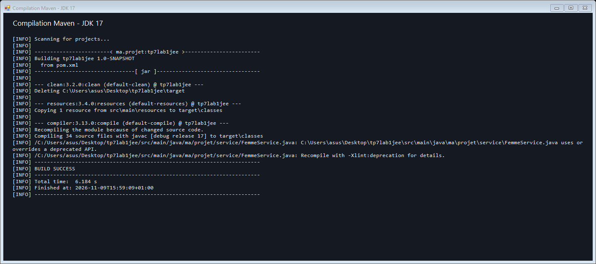

# TP 7 — Hibernate / JPA / MySQL

Trois applications console : gestion de stock, gestion de projets et état civil.
Java 17, Maven, Hibernate ORM 6 et MySQL 8. Compilation exécutée avec succès
avec le JDK 17. Les tests MySQL restent en attente de la configuration des identifiants.

## Structure

- `ma.projet.classes` : entités du stock et des projets, avec une base Entite.
- `ma.projet.beans` : Personne, Homme, Femme, Mariage ; héritage JPA JOINED.
- `ma.projet.dao.IDao<T>` : create, update, delete, findById et findAll.
- `ma.projet.service` : services CRUD et requêtes métier.
- `ma.projet.util` : HibernateUtil et validation des dates.
- `ma.projet.test` : programmes de vérification avec assertions explicites.
- `src/main/resources/application.properties` : configuration Hibernate.

Les associations passent par LigneCommandeProduit, EmployeTache et Mariage,
avec un identifiant technique. Les paires commande/produit et employé/tâche
sont uniques. Supprimer les objets dépendants avant leurs parents.

## Champs ajoutés

| Entité | Champs supplémentaires |
| --- | --- |
| Categorie | description |
| Produit | marque, stock |
| Commande | client, statut |
| LigneCommandeProduit | prixUnitaire au moment de la commande |
| Employe | email unique, specialite |
| Projet | budget, statut |
| Tache | priorite |
| EmployeTache | heuresPassees |
| Personne | cin unique |
| Mariage | lieu, numeroActe unique |

Les montants utilisent BigDecimal. Le stock est informatif : une ligne de
commande ne le décrémente pas automatiquement.

## Méthodes métier

| Service | Méthodes |
| --- | --- |
| ProduitService | produitsParCategorie, produitsCommandesEntreDates, produitsParCommande, afficherProduitsCommande, produitsPrixSuperieur100 |
| EmployeService | tachesRealisees, projetsGeres |
| ProjetService | tachesPlanifiees, tachesRealisees, afficherTachesRealisees |
| TacheService | tachesPrixSuperieur1000, tachesRealiseesEntreDates |
| HommeService | epousesEntreDates, hommesMariesAQuatreFemmes, nombreHommesMariesAQuatreFemmes |
| FemmeService | nombreEnfants, femmesMarieesAuMoinsDeuxFois, femmeLaPlusAgee |
| MariageService | mariagesHomme, afficherMariagesHomme |

Les autres services fournissent les opérations IDao. Produit, Tache et Femme
déclarent les requêtes nommées. Femme contient aussi la requête native nommée
du nombre d'enfants. HommeService emploie Criteria pour les quatre épouses.

## Règles des périodes

- Les bornes sont incluses ; un intervalle inversé est refusé.
- Les produits sont filtrés sur la date de commande, sans doublons.
- Une tâche réalisée possède une date de fin réelle. Le filtre entre dates
  demande que le début et la fin réels soient dans l'intervalle.
- Les dates réelles appartiennent à EmployeTache : plusieurs employés peuvent
  donner plusieurs lignes dans l'affichage des réalisations d'un projet.
- Une épouse est retenue si le mariage chevauche la période.
- Quatre épouses signifie exactement quatre femmes simultanément au moins
  un jour dans la période. Chaque homme est compté une seule fois.
- Un mariage en cours possède une date de fin nulle. Le jeu d'essai ne
  contient pas de fins futures.
- Le modèle ne donne pas les dates de naissance des enfants. Le calcul somme
  donc nbrEnfant des mariages ayant débuté dans la période ; il ne compte pas
  les naissances sur cette période.
- Le modèle conserve l'historique sans implémenter toutes les règles
  administratives relatives aux unions.

## Tester avant le dépôt GitHub

### 1. Outils

Installer un JDK 17 ou supérieur, Maven et MySQL 8, puis démarrer MySQL.
Dans PowerShell à la racine du projet :

```powershell
java -version
mvn -version
```

Vérifier que Maven utilise un JDK 17 ou supérieur.

### 2. Base de données

Dans MySQL Workbench, avec un compte administrateur :

```sql
CREATE DATABASE tp7lab1jee CHARACTER SET utf8mb4 COLLATE utf8mb4_unicode_ci;
CREATE USER 'tp7_user'@'localhost' IDENTIFIED BY 'REMPLACER_PAR_UN_SECRET_LOCAL';
GRANT ALL PRIVILEGES ON tp7lab1jee.* TO 'tp7_user'@'localhost';
```

Configurer la session PowerShell, sans écrire le mot de passe dans les fichiers :

```powershell
$env:DB_USER = "tp7_user"
$secret = Read-Host "Mot de passe MySQL" -AsSecureString
$env:DB_PASSWORD = [System.Net.NetworkCredential]::new("", $secret).Password
$env:DB_URL = "jdbc:mysql://localhost:3306/tp7lab1jee?serverTimezone=UTC&characterEncoding=UTF-8"
```

Hibernate charge application.properties puis les variables d'environnement.
Les tables et clés étrangères sont générées au premier démarrage avec
hibernate.hbm2ddl.auto=update. La base est créée par le SQL ci-dessus.

### 3. Compilation

```powershell
mvn clean compile
```

Attendre BUILD SUCCESS.

### 4. Tests d'intégration console

Sur une base vide, lancer tous les exercices :

```powershell
mvn exec:java "-Dexec.mainClass=ma.projet.test.TestComplet"
```

Les vérifications affichent [OK]. Une exception signale un échec.
Le résultat final doit être TOUTES LES VÉRIFICATIONS ONT RÉUSSI,
puis BUILD SUCCESS.

Autre possibilité : lancer chacun des exercices une fois :

```powershell
mvn exec:java "-Dexec.mainClass=ma.projet.test.TestStock"
mvn exec:java "-Dexec.mainClass=ma.projet.test.TestProjets"
mvn exec:java "-Dexec.mainClass=ma.projet.test.TestEtatCivil"
```

Choisir le lancement complet OU les lancements séparés. Les données restent
dans MySQL pour les captures. Les programmes refusent de repeupler un domaine
déjà rempli. Pour recommencer, créer une nouvelle base vide, accorder les droits
et adapter DB_URL. Faire de même après un échec ayant laissé des données partielles.

`mvn test` seul ne lance pas ces programmes console.

| Domaine | Résultats attendus |
| --- | --- |
| Stock | 3 produits dans INFO, 3 dans la commande, 2 à plus de 100 DH |
| Projets | 4 tâches planifiées, 3 terminées, 2 à plus de 1000 DH |
| État civil | 10 femmes, 5 hommes, première femme la plus âgée |
| Enfants | 2 pour la première femme sur 1989–2000 ; 0 pour la dixième |
| Remariages | 1 femme mariée au moins deux fois |
| Criteria | 1 homme avec quatre épouses simultanées sur 2005–2010 |
| Historique | 5 mariages pour le premier homme, dont 4 en cours |

Les programmes vérifient aussi une modification/suppression CRUD, des résultats
vides, les bornes des périodes, les dates inversées et un prix négatif.
Un homme ayant quatre unions successives doit être exclu du résultat Criteria.

Consulter les tables et les champs supplémentaires dans Workbench :

```sql
USE tp7lab1jee;
SHOW TABLES;
SELECT reference, prix, marque, stock FROM Produit;
SELECT nom, budget, statut FROM Projet;
SELECT numeroActe, dateDebut, dateFin, nbrEnfant, lieu FROM Mariage;
```

### 5. Résoudre les erreurs éventuelles

- Access denied : vérifier les identifiants et droits MySQL.
- Communications link failure : vérifier le service, le port et DB_URL.
- Unknown database : créer la base.
- Invalid target release : vérifier le JDK utilisé par Maven.
- Tables non vides : choisir une nouvelle base de test vide.
- BUILD FAILURE : lire la première exception, corriger et rejouer sur une base vide.

### 6. Dépôt sur GitHub

Placer les captures dans docs/screenshots et insérer les photos dans les espaces
ci-dessous sans ajouter de description. Ne versionner aucun mot de passe.
Après réussite des vérifications :

```powershell
git init
git add .
git diff --cached --check
git diff --cached
git status
git commit -m "Réaliser les trois exercices Hibernate avec champs supplémentaires"
git branch -M main
git remote add origin https://github.com/TON_COMPTE/TON_DEPOT.git
git push -u origin main
```

Si une origine existe déjà, vérifier git remote -v et conserver l'adresse
existante si elle correspond au dépôt souhaité.

## Captures d'écran

### Compilation


